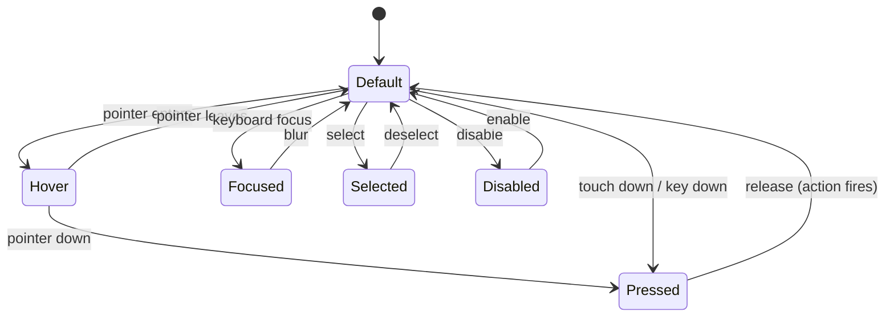

[CARBON](../../README.md) › Interaction › States

# States

Every interactive CARBON component uses the same state model. A state always changes **at least two cues**, and never relies on color, shadow or motion alone.

## State model

Focused, Selected and Error are **persistent** states that combine with the transient states (Hover, Pressed). Disabled overrides all others.

## The states

> **Decision:** the spatial behavior of each state is official; the implementation tokens are proposed. · **Official** / **Proposed**

| State | Spatial behavior · **Official** | Visual implementation · **Proposed** | Timing |
|---|---|---|---|
| Default | Stable baseline surface | The component's resting fill, edge, bevel and depth | — |
| Hover | Slight elevation | Raised controls: half a level up (`depth.hover.*`), optional −1px lift. Flat controls: `color.fill-hover` state layer. Text may move from Text Secondary to Text Primary. | `motion.hover` 160ms |
| Pressed | Slight downward movement | Shadow to `depth.pressed` (contact only), +1px down, bevel flattens to B0; flat controls: `color.fill-pressed` | `motion.press` 90ms |
| Selected | Surface and edge emphasis | Becomes a raised tile (Surface Elevated, B1, `depth.1`) or is ink-filled, **plus** a non-color indicator (check mark, indicator bar, weight 500, filled icon) | `motion.selection` 180ms |
| Focused | Clear focus indication without relying on elevation | 2px `color.focus` ring, 2px outside the component; depth unchanged | Instant (`motion.focus`, 0ms) |
| Disabled | Reduced visual emphasis | Flattened (`depth.0`, B0), Surface Secondary fill or none, Text Tertiary content, no state layers | `motion.surface` 220ms when toggled |
| Error | (component state) | Error edge (`color.error`), error icon, message in `color.error-aa` | Instant |
| Read-only | (component state) | Inset becomes flat Surface Secondary; value remains selectable and in Text Primary | — |
| Dragged | Detached from the plane | Rises to D3 while dragged; returns to its level on drop | `motion.elevation` 200ms |

## Rules per state

### Hover

1. Hover is a **hint**, never a requirement. Everything revealed on hover must also be reachable without hover, by focus, by press or by being always visible.
2. Only interactive elements respond to hover. Static cards and text never do.
3. Hover never crosses the resting/floating boundary and never moves large surfaces.
4. Do not change layout on hover: no size changes, no reflow, no revealing elements that push others.
5. On touch-only devices, hover styles must not "stick" after a tap (use hover-capable media conditions or platform equivalents).

### Pressed

1. Press feedback starts immediately on pointer down, touch down, or key down (Space and Enter).
2. The component moves *down*: it is pushed into the plane. It never scales up, glows or bounces.
3. Releasing outside the component cancels the action and returns it to default.

### Selected

1. Selection is expressed by **surface and edge emphasis** (a raised tile or ink fill) **plus** a shape or typographic cue.
2. Selected items in a set are visually equal in emphasis to each other. Only one item looks *current* in navigation.
3. Selection persists independently of focus: a selected item with focus shows both the selection tile and the focus ring.

### Focused

1. Every focusable element shows the focus ring on **keyboard** focus (`:focus-visible` or platform equivalent). Pointer clicks on buttons need not show it; text inputs always show it while focused.
2. The ring is 2px wide in `color.focus` (Text Primary: at least 11.66:1 against every surface), with a 2px gap, following the component's radius plus the gap (concentric).
3. The ring is never clipped by a parent's overflow and never obscured by sticky headers or overlays (WCAG 2.4.11).
4. Focus indication works without shadows, motion and color theming: it survives forced-colors mode as a system-color outline.
5. On ink-filled controls, the 2px gap shows the surface beneath, separating the ring from the ink.

### Disabled

1. Disabled controls are clearly distinguishable from enabled ones by **flatness and tone**: no depth, no bevel, a neutral fill and Text Tertiary content.
2. WCAG does not require contrast for disabled controls. CARBON still keeps disabled labels legible: Text Tertiary on Surface Secondary is 2.69:1 (Soft White) and 4.40:1 (Soft Black).
3. Prefer explaining *why* something is unavailable. A disabled control that has an explanation stays focusable (`aria-disabled`) and shows the reason in a tooltip or helper text.
4. Never use opacity alone for disabled states. Opacity changes the color of every layer, including shadows, and produces muddy, inconsistent results. Use the disabled tokens.

### Error

1. Errors are stated in text, with an icon, next to the cause. Color reinforces but never carries the error.
2. Error and focus combine: the focus ring stays `color.focus`; the error edge and message remain visible.
3. Errors appear on submit or blur, and clear as soon as the input becomes valid.

## Combining states

| Combination | Result |
|---|---|
| Hover + Selected | Selected appearance, plus `color.fill-hover` on flat items or `depth.hover.1` on raised tiles |
| Pressed + Selected | Selected tile presses down (`depth.pressed`) |
| Focused + any | The focus ring is added; nothing else changes |
| Error + Focused | Error edge and message, plus the focus ring |
| Disabled + any | Disabled only. A disabled control cannot be hovered, pressed or selected by the user. |

## State layers

Flat interactive surfaces (tertiary buttons, menu items, navigation items, list rows) express hover and pressed with **state layers**: translucent ink overlays composited over the element's own fill.

| Token | Value (both themes) | Use |
|---|---|---|
| `color.fill-hover` | Text Primary at 6% | Hover |
| `color.fill-pressed` | Text Primary at 10% | Pressed |

Because they are translucent, the same tokens work on every surface level in both themes. With reduced transparency, replace them with opaque equivalents (Surface Secondary for hover, Border for pressed). · **Proposed**

## Input without hover

> **Rule:** CARBON must remain fully usable without hover. · **Official**

| Capability | With pointer hover | Without hover (touch, keyboard, switch access) |
|---|---|---|
| Discover an action | Hover reveals the affordance | The affordance is always visible, or reachable via a visible overflow menu |
| Identify an icon button | Tooltip on hover | Tooltip on focus or long press; recognizable icon; accessible name |
| Preview interactivity | Hover elevation | Resting depth already signals that a control is operable |
| Get feedback | Hover, then press | Press feedback on touch down |

---

Previous: [Overlays](../components/overlays.md) · Next: [Motion](motion.md)
