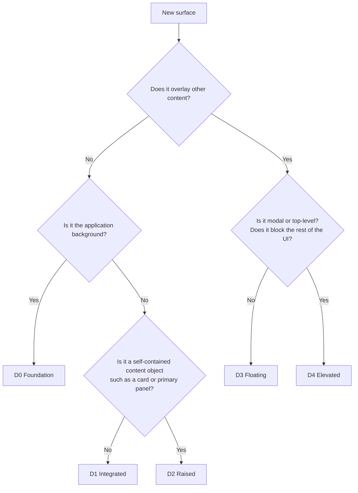

[CARBON](../../README.md) › Spatial Design System › Elevation

# Elevation

> **Decision:** CARBON has a five-level depth hierarchy, D0 to D4, rendered with **Pronounced Depth**. · **Official**

| Level | Name | Intended usage |
|---|---|---|
| D0 | Foundation | Application foundation and background |
| D1 | Integrated | Base surfaces and integrated regions |
| D2 | Raised | Cards and primary content panels |
| D3 | Floating | Toolbars, popovers, dropdowns |
| D4 | Elevated | Dialogs and top-level overlays |

## Reference values

> **Decision:** these are the initial visual design references. They are not universal rendering requirements. Platforms may tune values within the ranges to achieve the same perceived result. · **Reference**

| Level | Perceived elevation | Shadow blur | Shadow opacity |
|---|---|---|---|
| D0 | 0px | None | 0% |
| D1 | 1–2px | 4–8px | 6–10% |
| D2 | 4–6px | 12–20px | 10–16% |
| D3 | 8–12px | 24–36px | 14–22% |
| D4 | 12–18px | 36–52px | 18–26% |

## Shadow construction

A single shadow cannot express both contact and distance. Each CARBON depth level is a **stack of two layers**, both falling straight down (offsetX = 0) from the [single light environment](lighting.md#the-light-environment):

- **Key layer:** the main, soft shadow. Its offset, blur and opacity are the reference values above.
- **Near layer:** a small, tighter layer. For resting surfaces (D1, D2) it is the **contact shadow**, the occlusion where the surface touches the plane. For floating surfaces (D3, D4) it is a soft **penumbra**: the surface does not touch anything, so there is no sharp contact line.

```text
 resting (D1–D2)                          floating (D3–D4)
 ┌──────────────┐                          ┌──────────────┐
 └──────────────┘ ← contact: tight, dark   └──────────────┘
 ░░░░░░░░░░░░░░░░ ← key: soft ambient         ░░░░░░░░░░    ← penumbra: soft, near
                                         ░░░░░░░░░░░░░░░░░░ ← key: wide separation shadow
```

### Layer values

Geometry is shared by both themes (`elevation.*` primitives). Opacity is theme-specific. Soft White values are inside the reference ranges · **Reference**. Soft Black values are **Proposed** (see below).

| Level | Layer | Offset Y | Blur | Soft White opacity | Soft Black opacity | Token |
|---|---|---:|---:|---:|---:|---|
| D0 | — | 0 | 0 | 0% | 0% | `depth.0` |
| D1 | contact | 1px | 2px | 10% | 20% | `shadow.contact` |
| | key | 2px | 6px | 6% | 12% | in `depth.1` |
| D2 | contact | 1px | 2px | 10% | 20% | `shadow.contact` |
| | key (ambient) | 4px | 16px | 12% | 24% | `shadow.ambient` |
| D3 | penumbra | 2px | 6px | 10% | 20% | in `depth.3` |
| | key (floating) | 10px | 30px | 16% | 32% | `shadow.floating` |
| D4 | penumbra | 4px | 12px | 14% | 28% | in `depth.4` |
| | key | 16px | 48px | 22% | 44% | in `depth.4` |

Shadow ink: Soft White `#292927`; Soft Black `#060708`. Spread is 0 in every layer.

**Soft Black opacity.** Shadow contrast is much lower on dark surfaces: 12% of near-black over `#1C1F21` is barely visible. To keep the same *perceived* depth, Soft Black doubles the Soft White opacity. These values exceed the reference opacity ranges, which were calibrated for light surfaces. This is a deliberate, documented deviation. · **Proposed**

## How the cues combine

> **Rule:** every depth level differs from its neighbors by at least two cues, and never by shadow alone. · **Official**

| Level | Fill | Structural edge | Bevel | Shadow | Sheen |
|---|---|---|---|---|---|
| D0 Foundation | Background | — | B0 | none | none |
| D1 Integrated | Surface | Border, 1px | B1 | `depth.1` | ceramic |
| D2 Raised | Surface | Border, 1px | B2 | `depth.2` | ceramic |
| D3 Floating | Surface Elevated | Border, 1px | B2 | `depth.3` | ceramic |
| D4 Elevated | Surface Elevated | Border, 1px | B2 | `depth.4` | ceramic |
| Inset region | Surface Inset | Border or none | — | `shadow.inset` | none |

These combinations are available as composite **surface classes**: `surface.foundation`, `surface.integrated`, `surface.raised`, `surface.floating`, `surface.elevated` and `surface.inset`, each with `fill`, `edge` (where applicable) and `shadow` tokens. The `shadow` token already includes the bevel. · **Proposed**

How the balance shifts per theme:

| Cue | Carries more weight in Soft White | Carries more weight in Soft Black |
|---|---|---|
| Shadow | ✓ Shadows are clearly visible on light surfaces | Restrained and softer |
| Fill tone | Small steps (L* 94.4 → 97.2 → 98.3) | ✓ Clear steps (L* 7.6 → 11.5 → 18.2) |
| Edge highlight | Subtle | ✓ Main rim separating adjacent dark surfaces |
| Structural edge | Light definition | ✓ Essential definition |

## Bevel system

> **Decision:** CARBON has four bevel levels. **B2** is preferred for prominent spatial surfaces; **B1** is preferred for smaller controls and general-purpose components. · **Official**

| Level | Name | Description | Construction (`bevel.*`) · **Proposed** | Use |
|---|---|---|---|---|
| B0 | Flat edge | No edge treatment | none | Foundation, text, dividers, list rows, disabled controls |
| B1 | Subtle edge | A single top highlight | 1px top inner highlight (`light.edge`) | Buttons, secondary controls, selected tiles, D1 panels |
| B2 | Soft bevel | Top highlight and bottom shade: a soft rounded edge | B1 + 1px bottom inner shade (`light.occlusion`) | Cards, D3 and D4 surfaces, prominent panels |
| B3 | Clearly perceptible curved transition | Highlight and shade spread over 4px: a visibly rounded edge | B2 + 4px soft inner highlight and 4px soft inner shade | Tactile grips (switch and slider thumbs), Carbon Composite brand plates |

Rules:

1. One component uses one bevel level in every state, except that pressed and disabled states flatten it (see [Interactive depth](#interactive-depth)).
2. Ink-filled controls (primary, destructive, checked) use a B1 highlight with `light.edge-inverse` instead of `light.edge`.
3. B3 must not be used on containers, inputs or text-bearing buttons. It is reserved for objects meant to be grabbed and for brand plates.
4. Bevels are inner treatments. They never enlarge a component or change its layout box.

## Inset regions

Inset regions are recessed into the surface they belong to: input wells, switch and segmented tracks, code blocks, drop zones. They are not a depth level and do not change the stacking order.

- Fill: `color.surface-inset`, which is darker than its surroundings in both themes.
- Inner occlusion: `shadow.inset`, a 1px / 2px inner shadow at the top edge.
- No sheen, no bevel highlight.
- Text inside inset regions must use colors that meet contrast on Surface Inset (see [Colors](../foundations/colors.md#accessible-variants)).

## Choosing a level



| Component | Level | Notes |
|---|---|---|
| Window background | D0 | |
| Sidebar on the foundation | D0 | Navigation sits directly on the foundation in the default composition |
| Content panel, inspector, integrated toolbar | D1 | |
| Card, primary content panel | D2 | |
| Menu, dropdown, popover, tooltip | D3 | |
| Floating toolbar (over a canvas or content) | D3 | Only when it overlays content |
| Dialog, sheet, command palette | D4 | |
| Toast or notification | D3 | Overlays content but is not modal · **Proposed** |

**Never** raise a surface to make it more important. A primary call-to-action card is still D2; express importance through position, typography and the ink emphasis of the monochrome brand.

## Interactive depth

> **Decision:** spatial appearance responds naturally to interaction. · **Official**

| State | Spatial behavior (Official) | Implementation · **Proposed** |
|---|---|---|
| Default | Stable baseline surface | The level's shadow and bevel |
| Hover | Slight elevation | Half a level up: `depth.hover.1` for D1 surfaces, `depth.hover.2` for D2 surfaces. Controls may also lift by `lift.hover` (−1px). |
| Pressed | Slight downward movement | Shadow reduces to `depth.pressed` (contact only); controls move down by `lift.pressed` (+1px); bevel flattens to B0 |
| Selected | Surface and edge emphasis | The selected item becomes a raised tile (Surface Elevated, B1, `depth.1`) and gains a non-color indicator |
| Focused | Clear focus indication without relying on elevation | 2px `color.focus` ring with a 2px offset. Elevation does not change on focus. |
| Disabled | Reduced visual emphasis | Flattened: `depth.0`, B0, Surface Secondary fill, Text Tertiary label |

Rules:

1. **Hover never crosses the resting/floating boundary.** A D2 card on hover reaches halfway to D3, never D3 itself.
2. **Floating and elevated surfaces do not lift on hover.** Their items respond with state layers instead.
3. **Hover is never required.** Every hover affordance has a non-hover equivalent, because touch and keyboard users have no hover. Pressed, focused, selected and disabled states carry all essential meaning.
4. **Large surfaces do not move.** Cards and panels never translate; only their shadow changes. Lift is for controls.
5. Elevation transitions use `motion.elevation` (200ms); press uses `motion.press` (90ms). See [Motion](../interaction/motion.md).

Full state specifications: [States](../interaction/states.md).

## Layering and stacking

· **Proposed**

| Stratum | Token | Value | Contents |
|---|---|---:|---|
| Base | `layer.base` | 0 | D0–D2 content |
| Sticky | `layer.sticky` | 100 | Sticky headers, pinned toolbars |
| Floating | `layer.floating` | 1000 | D3: menus, popovers, floating toolbars, toasts |
| Overlay | `layer.overlay` | 2000 | D4 surfaces and their scrim |
| Tooltip | `layer.tooltip` | 3000 | Tooltips, always on top |

Rules:

1. **Opener order wins within a stratum.** An overlay opened from inside another overlay stacks directly above its opener. For example, a dropdown inside a dialog renders above the dialog even though D3 is a lower stratum than D4.
2. **One modal at a time.** Avoid stacking dialogs. If a dialog must open another, the second replaces the first, or the first steps back behind the shared scrim.
3. **Scrim.** D4 surfaces sit over `color.scrim`. The scrim dims, it does not blur by default (see [Overlays](../components/overlays.md#dialogs)).
4. **Shadows do not accumulate.** A D3 menu inside a D4 dialog uses the D3 shadow, not D3 plus D4.

## Platform rendering

Shadow rendering differs by platform. Preserve the **relationships** between levels (order, relative strength, direction) rather than exact pixel values. · **Platform note**

| Platform | Guidance |
|---|---|
| Web | `box-shadow` stacks map directly from the tokens. To animate elevation cheaply, crossfade a pre-rendered shadow on a pseudo-element (`opacity`) instead of animating `box-shadow`. |
| Windows (WinUI) | Use composition drop shadows or `ThemeShadow` with Z translation for D3–D4; tune to the reference ranges. Respect system transparency and animation settings. |
| macOS and iOS | Layer shadows (`shadowOffset`, `shadowRadius`, `shadowOpacity`; radius is about half the CSS blur). Supply a `shadowPath` for performance. |
| Android | Elevation shadows are light-source based. Map D1 to 1dp, D2 to 3dp, D3 to 6dp and D4 to 12dp as a starting point; set ambient and spot shadow colors to the theme ink (API 28+). |
| Linux | Compositor support varies. Draw shadows in-app (client-side) when possible; without a compositor, fall back to edges and tone. |

## Avoid

- Raising surfaces for emphasis.
- Making every element float (see [Composition](composition.md)).
- Single, generic drop shadows applied identically to everything.
- Shadows with horizontal offsets, colored shadows, or shadows that ignore the theme ink.
- Mixing bevel levels within one component family.
- Communicating state with shadow alone.

---

Previous: [Lighting](lighting.md) · Next: [Composition](composition.md)
