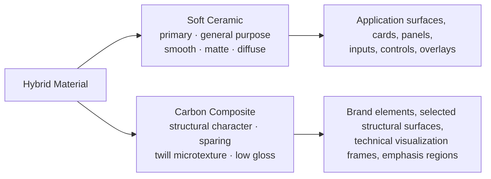

[CARBON](../../README.md) › Spatial Design System › Materials

# Materials

> **Decision:** CARBON uses a **Hybrid Material** system of two complementary material identities: **Soft Ceramic** and **Carbon Composite**. All materials are matte or softly reflective. · **Official**



## Soft Ceramic

> **Decision:** Soft Ceramic is the primary, general-purpose surface material. · **Official**

| Characteristic | Visual realization |
|---|---|
| Smooth matte surface | Opaque fill, no texture, no specular highlight |
| Soft visual appearance | Rounded geometry, soft bevels (B1–B2) |
| Subtle surface transitions | Diffuse sheen: a lit top that falls off to neutral and slight shade |
| Diffuse light response | Highlights and shadows are soft and wide; nothing is mirror-like |
| Comfortable visual character | Calm tones from the Soft White and Soft Black palettes |

**Applications:** main application surfaces, cards, content panels, inputs, menus, dialogs and general UI components.

### Recipe

A Soft Ceramic surface is composed from four layers, bottom to top:

| Layer | Token | Notes |
|---|---|---|
| 1. Fill | `surface.<level>.fill` | Opaque; from the theme palette |
| 2. Sheen | `material.ceramic.sheen` → `light.diffuse` | Top-to-bottom gradient overlay; strength `material.ceramic.sheen-strength` (1.0). Omit on D0 and inset regions. |
| 3. Edge and bevel | `surface.<level>.edge`, `bevel.1` or `bevel.2` | 1px structural edge; inner highlight and shade |
| 4. Shadow | `depth.<n>` | Contact and ambient layers per [Elevation](elevation.md) |

`material.ceramic.texture-opacity` is 0: Soft Ceramic never has texture.

## Carbon Composite

> **Decision:** Carbon Composite provides structural character and distinctive material detail, with a subtle carbon-fiber-inspired microtexture, a low-gloss finish and refined edge details. · **Official**

| Characteristic | Visual realization |
|---|---|
| Structured material appearance | A 2/2 twill microtexture at 45°: alternating blocks of "tows" |
| Subtle microtexture | Weave colors at very low alpha; invisible at reading distance on most displays, perceptible up close |
| Low-gloss finish | Sheen at 60% of ceramic strength (`material.composite.sheen-strength` = 0.6) |
| Refined edge details | B2 bevel on panels, B3 on brand plates; crisp 1px structural edge |
| Strength and precision | Exact pitch (4px), pixel-aligned rendering, no distortion |

**Applications:** brand elements, selected structural surfaces, technical visualization (frames and chrome only), and special emphasis regions.

### Microtexture specification

· **Proposed**

| Parameter | Token | Value |
|---|---|---|
| Weave | — | 2/2 twill: each tow passes over two and under two crossing tows, shifted one step per row |
| Tow width (pitch) | `material.composite.weave-pitch` | 4px (repeat = 8px) |
| Angle | `material.composite.weave-angle` | 45° |
| Shade tows | `material.composite.weave-shade` | Soft White: `#292927` at 4.5% · Soft Black: `#060708` at 28% |
| Lit tows | `material.composite.weave-highlight` | Soft White: white at 35% · Soft Black: `#ECECE8` at 3.5% |
| Base | — | The surface fill of the level it sits on |

Rendering requirements:

1. **Pixel alignment.** Render the texture at device resolution and align the tile to the device-pixel grid. A misaligned tile shimmers when scrolling.
2. **Static.** Never animate, parallax or scroll-shift the texture relative to its surface.
3. **Density.** On displays where a 4px pitch causes moiré (rare; some 1× displays at fractional scaling), increase the pitch to 6px rather than removing the texture.
4. **Implementation.** Prefer a pre-rendered tile (SVG or bitmap at 1×/2×/3×) generated from the weave tokens. In CSS without rotation, an axis-aligned checker at the same pitch is an accepted approximation.

### Rules

1. **Never behind reading text or data.** Texture under text lowers legibility. Inside a composite region, text and data sit on a Soft Ceramic sub-surface or on a texture-free band.
2. **Frames, not fields, in technical visualization.** Use composite on the chrome of a gauge, chart frame, viewport bezel or instrument panel, never on the plot area.
3. **Coverage limit.** Carbon Composite covers at most **15%** of the visible interface area in any view (`material.hybrid.composite-coverage-max`).
4. **Not on controls.** Buttons, inputs and other interactive controls are Soft Ceramic. The exception is brand plates that act as links (for example, an "About" logo plate).
5. **No meaning.** The texture never encodes state or information.
6. **Removed in high-contrast and forced-colors modes**, and when printing.

## Hybrid Material rules

> **Decision:** · **Official**
>
> - Soft Ceramic is the primary general-purpose surface material.
> - Carbon Composite provides structural character and distinctive material details.
> - Do not apply carbon-fiber patterns to every component.
> - Do not turn the interface into a literal carbon-fiber texture showcase.
> - Keep all materials matte or softly reflective.
> - Preserve visual harmony between Light and Dark themes.

### Material assignment

| Surface or component | Material |
|---|---|
| D0 Foundation | Soft Ceramic (no sheen) |
| Panels, cards, popovers, menus, dialogs | Soft Ceramic |
| Inputs and other inset regions | Soft Ceramic (no sheen; inner occlusion) |
| Buttons, checkboxes, switches and all controls | Soft Ceramic (ink-filled controls are ceramic in inverse tone) |
| App icon, splash screen, about screen, brand plates | Carbon Composite |
| Selected structural surfaces: a tool rail, a status bar, a hero band | Carbon Composite, optional, within the coverage limit |
| Technical visualization frames: gauge bezels, chart and viewport frames | Carbon Composite on the frame only |
| Special emphasis regions: a featured section header | Carbon Composite, one per view at most |

### Theme harmony

| Aspect | Soft White | Soft Black |
|---|---|---|
| Ceramic character | Soft, bright, matte porcelain | Deep, matte charcoal stoneware |
| Sheen | White lit top at 40% fading to neutral, bottom shade 2.5% | Lit top at 4%, bottom shade 12% |
| Composite texture | Mostly shade tows (light surfaces show texture through shading) | Mostly shade tows with very faint lit tows |
| Edge highlight | Subtle; most visible on Surface Secondary and inset tones | Subtle; the main separation cue between adjacent surfaces |

Equal visual weight is the goal: a composite plate should look equally subtle in both themes. Verify both themes side by side whenever material values change.

## Implementation examples

These examples are illustrative, not required implementations. · **Platform note**

```css
/* Soft Ceramic raised surface (CSS adapter) */
.card {
  background-color: var(--carbon-card-fill);
  background-image: var(--carbon-material-ceramic-sheen);
  border: var(--carbon-border-width) solid var(--carbon-card-edge);
  border-radius: var(--carbon-card-radius);
  box-shadow: var(--carbon-card-elevation);
}

/* Carbon Composite plate: axis-aligned checker approximation of the twill */
.brand-plate {
  --pitch: var(--carbon-material-composite-weave-pitch);
  background-color: var(--carbon-color-surface);
  background-image: conic-gradient(
    var(--carbon-material-composite-weave-shade) 0 25%,
    var(--carbon-material-composite-weave-highlight) 0 50%,
    var(--carbon-material-composite-weave-shade) 0 75%,
    var(--carbon-material-composite-weave-highlight) 0
  );
  background-size: calc(var(--pitch) * 2) calc(var(--pitch) * 2);
  box-shadow: var(--carbon-bevel-3), var(--carbon-depth-2);
}
```

- **Native desktop and mobile:** draw the sheen as a linear gradient layer and the composite texture as a tiled image asset generated from the tokens at each display scale.
- **Performance:** both layers are static. Rasterize them once per size and do not recompute them during animation.

## Avoid

- Carbon-fiber texture on every surface, or as a full-window background.
- Glossy, metallic, chrome or glass materials (see [Anti-patterns](../anti-patterns.md)).
- Texture under text, data, icons or controls.
- Different materials for the same component in the two themes.

---

Previous: [Spatial overview](overview.md) · Next: [Lighting](lighting.md)
