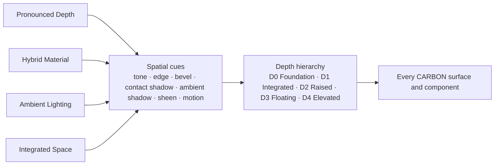

[CARBON](../../README.md) › Spatial Design System › Overview

# Spatial Design System 1.0

The Spatial Design System is one of CARBON's defining characteristics. CARBON interfaces convey **physical structure**: volume, surface curvature, thickness and spatial relationships. They never rely on flat surfaces with decorative drop shadows.

## The four spatial decisions

> **Decision:** CARBON's spatial direction is **Pronounced Depth + Hybrid Material + Ambient Lighting + Integrated Space**. · **Official**

| Dimension | Official choice | Meaning | Specification |
|---|---|---|---|
| Depth intensity | **Pronounced** | Depth is clearly perceptible at a glance, yet restrained. | [Elevation](elevation.md) |
| Material | **Hybrid Material** | Soft Ceramic surfaces combined with Carbon Composite details. | [Materials](materials.md) |
| Lighting | **Ambient** | One soft, coherent light environment, without spotlights. | [Lighting](lighting.md) |
| Spatial composition | **Integrated** | Surfaces form one continuous environment, not scattered floating objects. | [Composition](composition.md) |



## Core spatial philosophy

### Physical Presence

> **Decision:** UI surfaces feel physically present. · **Official**

- **What.** A surface's form is recognizable through **elevation**, **thickness**, **surface curvature**, **edge treatment**, **contact shadows** and **ambient shading**.
- **Why.** Physical cues are understood pre-attentively. Users perceive which surface is on top, what can be pressed and what belongs together before they read anything.
- **How.** Every raised surface combines a fill tone, a structural edge, a bevel and a shadow stack (see [How the cues combine](elevation.md#how-the-cues-combine)). Interactive surfaces respond physically: they lift slightly on hover and press down when pressed.
- **Avoid.** Flat rectangles with a single generic drop shadow, and shadows with no surface logic behind them.

### Material Harmony

> **Decision:** CARBON combines the characteristics of **Soft Ceramic** and **Carbon Composite**. · **Official**

- **What.** Soft Ceramic, a smooth, matte, diffuse material, is the general-purpose surface. Carbon Composite, a structured, low-gloss material with a subtle twill microtexture, adds structural character in selected places.
- **Why.** Ceramic alone would be soft but anonymous; composite alone would be heavy and literal. Together they are approachable and distinctive.
- **How.** See [Materials](materials.md).
- **Avoid.** Carbon-fiber texture on every component; glossy or glassy materials.

### Ambient Continuity

> **Decision:** lighting is one coherent environment, not shadows attached to individual components. · **Official**

- **What.** One soft light environment, slightly biased from above, illuminates every surface. All shadows, bevels and sheens agree with it.
- **Why.** Inconsistent lighting is the fastest way to make a spatial interface look fake.
- **How.** See [Lighting](lighting.md). Shadows always fall downward; highlights are always on top edges.
- **Avoid.** Per-component shadow directions, colored glows, spotlights.

### Structural Integration

> **Decision:** UI elements form one continuous spatial composition. · **Official**

- **What.** Surfaces are built into a shared foundation, nested and grouped. They do not hover independently.
- **Why.** An arbitrary collection of floating objects has no structure, which contradicts Structural Minimalism.
- **How.** See [Composition](composition.md). Most surfaces rest (D1–D2); only transient or overlaying surfaces float (D3–D4).
- **Avoid.** Every card, button and section floating on its own shadow.

## The spatial model

CARBON models the interface as a physical scene viewed from the front, under soft light from above:

```text
        soft ambient light, biased from above
        ↓    ↓    ↓    ↓    ↓    ↓    ↓    ↓

        ┌──────────────┐                         D4  Elevated    dialog
        └──────────────┘                              detached: large, soft separation shadow
             ░░░░░░
                         ┌────────┐              D3  Floating    menu, popover, floating toolbar
                         └────────┘                   detached: separation shadow
                            ░░░░
   ┌────────────────────────────────────┐        D2  Raised      card: resting, contact + ambient shadow
 ┌─┴────────────────────────────────────┴─┐      D1  Integrated  panel: resting, contact shadow
 │      └──── inset well ────┘            │          inset region carved into D1: inner occlusion
═╧════════════════════════════════════════╧═══   D0  Foundation  application background (the plane)
```

| Concept | Description |
|---|---|
| **Foundation (D0)** | The plane. It fills the window and is the reference for all depth. |
| **Resting surfaces (D1–D2)** | Surfaces that sit *on* the plane. They show **contact** shadows: occlusion where they touch. |
| **Floating surfaces (D3–D4)** | Surfaces detached from the plane. They show **separation** shadows: a gap of light between them and what lies beneath. |
| **Inset regions** | Recesses carved *into* a surface (input wells, tracks). Not a depth level. They show inner occlusion. |
| **Thickness** | Expressed by bevel and edge: a top highlight and a bottom shade imply a rounded edge with physical depth. |

## Pronounced Depth

"Pronounced" defines the intensity:

| Intensity | Description | CARBON? |
|---|---|---|
| Flat | No perceptible depth; hierarchy by color and lines only | No |
| Subtle | Depth noticeable only on inspection | No |
| **Pronounced** | Depth clearly perceptible at a glance; surfaces read as objects; still calm | **Yes** |
| Dramatic | Heavy shadows, strong bevels and highlights; depth dominates content | No |

Pronounced Depth is achieved by combining cues, **not** by making any single cue heavy. A D2 card in Soft White has a 4px / 16px ambient shadow at 12% opacity, a contact shadow, a soft bevel and a structural edge. Each is restrained; together they are unmistakable.

## Minimum necessary elevation

> **Rule:** use the minimum elevation necessary to communicate the intended spatial hierarchy. A component does not become floating merely because it is visually important. · **Official**

- Importance is expressed through position, size, typography and the ink emphasis of the monochrome brand, **not** through elevation.
- Elevation expresses **spatial relationship**: resting (D1–D2) or overlaying (D3–D4).
- A surface may only float (D3–D4) if it overlays other content, either transiently or as a movable tool.

## Graceful degradation

Spatial effects are enhancements of a structure that must work without them. · **Official**

| Condition | What degrades | What must remain |
|---|---|---|
| No shadow rendering (some Linux compositors, low-power modes, forced colors) | Shadows, bevels | Tone steps, structural edges (borders), spacing, seams |
| Reduced transparency | Translucent scrims and state layers | Opaque equivalents |
| Reduced motion | Lift and press movement | Instant state changes and crossfades |
| High contrast / forced colors | Tones, shadows, textures | System-color borders and focus indicators |
| Low-end hardware | Large blurs, animated shadows | Static depth, tone, edges |

---

Previous: [Geometry](../foundations/geometry.md) · Next: [Materials](materials.md)
