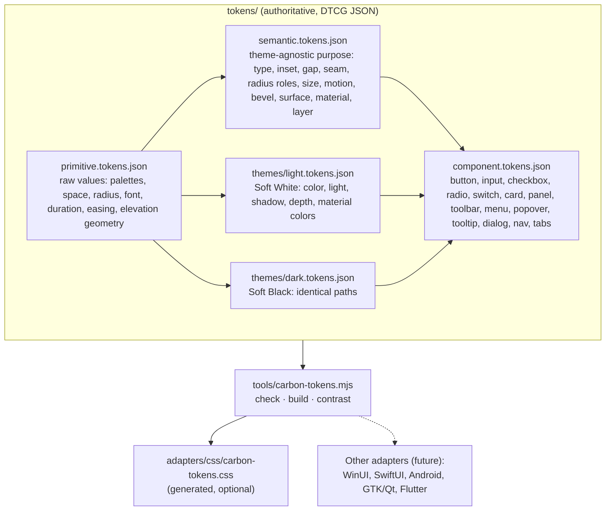

[CARBON](../README.md) › Design tokens

# Design tokens

> **Decision:** CARBON's design decisions are stored once, as platform-neutral design tokens in [`tokens/`](../tokens/README.md), in the W3C Design Tokens Community Group (DTCG) format, version 2025.10. Every platform implementation is derived from that source. · **Official** (architecture) / values carry their own status

## Principles

1. **Single source of truth.** Values live in the token JSON. Documentation explains and references them; adapters are generated from them. Nothing is re-typed by hand.
2. **Platform-neutral.** Tokens describe design decisions (a color, a dimension in density-independent pixels, a duration), not CSS or any platform syntax.
3. **Three layers.** Primitive → Semantic → Component. Products consume semantic and component tokens only.
4. **Theme parity.** Soft White and Soft Black define exactly the same semantic tokens.
5. **Status travels with the value.** Each token carries its status (official, reference or proposed).
6. **Verified.** `node tools/carbon-tokens.mjs check` validates structure, references, parity, accessibility guarantees and documentation consistency.

## Architecture



A **resolution set** for one theme is: primitive + semantic + that theme's file + component. Semantic and component tokens that reference theme tokens (`{color.surface}`, `{depth.2}`) resolve differently in each theme, so components do not need theme-specific tokens.

| File | Layer | Contents |
|---|---|---|
| [`primitive.tokens.json`](../tokens/primitive.tokens.json) | Primitive | Soft White and Soft Black palettes, semantic hues, white highlight; space; radius; font families, weights and sizes; durations; easing curves; elevation geometry |
| [`semantic.tokens.json`](../tokens/semantic.tokens.json) | Semantic (theme-agnostic) | Font stacks; type styles; inset, gap and seam; radius roles; sizes; border, focus, indicator and lift geometry; motion transitions; layers; breakpoints and layout; bevels; surface classes; material parameters |
| [`themes/light.tokens.json`](../tokens/themes/light.tokens.json) | Semantic (Soft White) | Colors, lighting, shadow layers, depth stacks, material colors |
| [`themes/dark.tokens.json`](../tokens/themes/dark.tokens.json) | Semantic (Soft Black) | The same paths with Soft Black values |
| [`component.tokens.json`](../tokens/component.tokens.json) | Component | Component-specific decisions expressed through semantic tokens |

## Format

CARBON uses DTCG 2025.10 syntax:

| Property | Use in CARBON |
|---|---|
| `$value` | The value, or a reference `{group.token}` |
| `$type` | Declared on a group and inherited by its tokens, or on the token |
| `$description` | Purpose and usage, written for designers, developers and AI agents |
| `$extensions.carbon.status` | `official`, `reference` or `proposed`. **CARBON convention:** a status set on a group applies to every token in it unless a token overrides it. Tokens without a status anywhere in their ancestry are `official`. |
| `$extensions.carbon.proposedFields` | For composite tokens with official and proposed parts, the proposed sub-values (for example `lineHeight` and `letterSpacing` in official type styles) |
| `$extensions.carbon.textTransform` | Text transform for type styles (Overline: `uppercase`), which DTCG typography does not include |

Value formats:

| Type | Example |
|---|---|
| `color` | `{"colorSpace": "srgb", "components": [0.9412, 0.9373, 0.9216], "hex": "#F0EFEB"}`, plus `"alpha"` for translucent values. `hex` is the human-readable value; `check` verifies that it matches `components`. |
| `dimension` | `{"value": 16, "unit": "px"}`. `px` means density-independent pixels. |
| `duration` | `{"value": 200, "unit": "ms"}` |
| `cubicBezier` | `[0.2, 0, 0, 1]` |
| `fontFamily`, `fontWeight`, `number` | Native JSON values |
| `shadow` | A shadow object or an array of them. CARBON composes stacks by referencing other shadow tokens inside the array (`["{bevel.2}", "{depth.2}"]`); tools must flatten referenced arrays. |
| `gradient` | Array of `{color, position}` stops; direction is top to bottom |
| `typography` | `{fontFamily, fontSize, fontWeight, lineHeight, letterSpacing}` with a unitless `lineHeight` |
| `transition` | `{duration, delay, timingFunction}` |

## Naming

| Rule | Example |
|---|---|
| Path segments are lowercase kebab-case | `color.surface-elevated`, `inset.control-x` |
| Order: category → concept → variant → state | `button.primary.shadow-hover`, `nav.item-fill-selected` |
| References use dot paths | `{color.text-primary}` |
| Platform names join the path with hyphens, with a `carbon` prefix | CSS `--carbon-color-surface-elevated`; Swift `carbonColorSurfaceElevated`; Android `carbon_color_surface_elevated` |
| Primitive color steps are tones: CIELAB L* × 10 | `color.soft-white.944` has L* 94.4 |
| Space steps are multiples of the 4px unit | `space.4` = 16px |
| Duration steps are milliseconds | `duration.200` |
| `-aa` suffix: guaranteed WCAG AA for its role on every surface of its theme | `color.text-tertiary-aa`, `color.border-aa` |
| Names describe purpose, never appearance, in semantic and component layers | `color.surface-inverse`, not `color.dark-gray` |

The documentation refers to tokens by path (`color.surface`) or by the hyphenated name used in the specification (`surface-raised`, `depth-2`); they are the same token.

## Layers

### Primitive tokens

Raw foundational values. Products never consume them directly.

| Group | Contents |
|---|---|
| `color.soft-white.*`, `color.soft-black.*` | The two neutral palettes, keyed by tone |
| `color.green`, `amber`, `red`, `blue` | Semantic hues and their accessible variants |
| `color.white` | Highlight tint (partial alpha only) |
| `space.*` | 4, 8, 12, 16, 20, 24, 32, 40, 48, 64, 80px |
| `radius.*` | none, xs–3xl, full |
| `font.family.*`, `font.weight.*`, `font.size.*` | Typography raw values |
| `duration.*`, `easing.*` | Motion raw values |
| `elevation.*` | Shadow geometry (offset, blur) for each level and layer |

### Semantic tokens

Purpose-based values. Theme-specific ones live in the theme files; the rest in `semantic.tokens.json`.

| Purpose | Tokens |
|---|---|
| Background | `color.background`, `surface.foundation.*` |
| Surface | `color.surface`, `color.surface-secondary`, `surface.integrated.*`, `surface.raised.*` |
| Surface Elevated | `color.surface-elevated`, `surface.floating.*`, `surface.elevated.*` |
| Surface Inset | `color.surface-inset`, `surface.inset.*` |
| Text | `color.text-primary`, `color.text-secondary`, `color.text-tertiary`, their `-aa` variants, `color.text-inverse` |
| Border | `color.border`, `color.border-strong`, `color.border-aa`, `border.width` |
| Focus | `color.focus`, `focus.width`, `focus.offset` |
| Shadow | `shadow.*`, `depth.*` |
| Material | `material.ceramic.*`, `material.composite.*`, `material.hybrid.*` |
| Lighting | `light.ambient`, `light.diffuse`, `light.edge`, `light.edge-inverse`, `light.occlusion` |
| Typography | `font.family.sans`, `font.family.mono`, `type.*` |
| Spacing | `inset.*`, `gap.*`, `seam.*`, `layout.*` |
| Geometry | `radius.<role>`, `size.*`, `indicator.*`, `lift.*` |
| Motion | `motion.*` |
| Stacking | `layer.*` |

### Component tokens

Component-specific decisions, always expressed through semantic tokens (for example `button.radius` → `{radius.control}`, `card.elevation` → `{surface.raised.shadow}`, `input.fill` → `{surface.inset.fill}`, `dialog.shadow` → `{surface.elevated.shadow}`, `toolbar.floating.surface` → `{surface.floating.fill}`, `card.padding` → `{inset.default}`). Add component tokens only when a component needs a decision that differs from, or must be tunable independently of, the semantic default.

## Spatial tokens

The spatial token group implements the [Spatial Design System](spatial/overview.md). It spans the layers: geometry in primitives, theme-specific light and shadow in the theme files, composition in the semantic file.

| Specification name | Token path | Type | Location | Description |
|---|---|---|---|---|
| `depth-0` … `depth-4` | `depth.0` … `depth.4` | shadow | themes | Complete shadow stack for D0–D4 |
| — | `depth.hover.1`, `depth.hover.2`, `depth.pressed` | shadow | themes | Interactive depth |
| `shadow-contact` | `shadow.contact` | shadow | themes | Contact occlusion under resting surfaces |
| `shadow-ambient` | `shadow.ambient` | shadow | themes | Broad ambient occlusion (D2 key layer) |
| `shadow-floating` | `shadow.floating` | shadow | themes | Separation shadow (D3 key layer) |
| — | `shadow.inset` | shadow | themes | Inner occlusion of inset regions |
| `light-ambient` | `light.ambient` | color | themes | Ambient illumination tint |
| `light-diffuse` | `light.diffuse` | gradient | themes | Diffuse falloff across a surface |
| `light-edge` | `light.edge` | color | themes | Edge highlight (`light.edge-inverse` on ink fills) |
| — | `light.occlusion` | color | themes | Inner shade for bevels |
| `material-ceramic` | `material.ceramic.*` | group | semantic | Soft Ceramic: sheen, sheen strength, texture opacity |
| `material-composite` | `material.composite.*` | group | semantic + themes | Carbon Composite: sheen strength, weave pitch and angle; weave colors |
| `material-hybrid` | `material.hybrid.*` | group | semantic | Hybrid rules: composite coverage limit |
| `bevel-0` … `bevel-3` | `bevel.0` … `bevel.3` | shadow (inset) | semantic | Bevel system B0–B3 |
| `surface-foundation` | `surface.foundation.*` | group | semantic | D0 fill and shadow |
| — | `surface.integrated.*` | group | semantic | D1 fill, edge, shadow |
| `surface-raised` | `surface.raised.*` | group | semantic | D2 fill, edge, shadow |
| `surface-floating` | `surface.floating.*` | group | semantic | D3 fill, edge, shadow |
| — | `surface.elevated.*`, `surface.inset.*` | group | semantic | D4 and inset regions |
| `motion-elevation` | `motion.elevation` | transition | semantic | 200ms depth transitions |
| `motion-press` | `motion.press` | transition | semantic | 90ms press transitions |
| `motion-surface` | `motion.surface` | transition | semantic | 220ms surface transitions |

**Composite groups.** DTCG has no "material" or "surface" type, so `material-*` and `surface-*` are **groups** of typed tokens rather than single tokens. A surface class is applied by using all of its members together: `fill`, `edge` and `shadow` (the shadow already includes the bevel).

## Theme parity

> **Rule:** `themes/light.tokens.json` and `themes/dark.tokens.json` define exactly the same token paths with the same types. A token may not exist in only one theme. `check` fails otherwise. · **Official**

When a decision needs no theme difference, place it in `semantic.tokens.json` instead of duplicating it in both theme files. When a token's value is identical in one theme but adjusted in the other (for example `color.success-aa`), the unadjusted theme aliases the baseline token.

## Using tokens

| Do | Don't |
|---|---|
| Use component tokens for components and semantic tokens elsewhere | Use primitives (`color.soft-white.972`) or hex values in products |
| Reference tokens from documentation by path | Copy values into documentation without a token |
| Add a semantic token when an intent is missing | Create one-off component values for an existing intent |
| Generate platform resources from the JSON | Maintain hand-written per-platform copies |

**Adding or changing a token**

1. Add it in the correct layer and file; give it a `$description` and, unless it is official, a status.
2. For theme tokens, add it to both theme files.
3. Reference it from the relevant documentation.
4. Run `node tools/carbon-tokens.mjs build`, then `node tools/carbon-tokens.mjs check`.
5. Record it in the [changelog](../CHANGELOG.md) with the appropriate version bump.

## Adapters

### CSS custom properties

[`adapters/css/carbon-tokens.css`](../adapters/css/carbon-tokens.css) is an optional, generated adapter. It is **not** the source of truth.

| Feature | Behavior |
|---|---|
| Variable names | `--carbon-` + token path joined with hyphens |
| Themes | Soft White on `:root` and `[data-carbon-theme="light"]`; Soft Black on `[data-carbon-theme="dark"]` and on `:root` when `prefers-color-scheme: dark` (unless the light theme is explicitly set) |
| Scoped theming | Semantic and component tokens are re-declared on every `[data-carbon-theme]` element, so a dark-themed region inside a light page resolves correctly |
| References | Emitted as `var()` references, so the theme cascades through every layer |
| Font sizes | Emitted in `rem` (px ÷ 16) to respect browser text-size settings |
| Typography | Each `type.*` style yields `font` shorthand plus `-font-family`, `-font-size`, `-font-weight`, `-line-height`, `-letter-spacing` and `-text-transform` properties |
| Shadows | Stacks become comma-separated `box-shadow` lists; transparent zero shadows are emitted as valid no-op layers so stacks can always be combined |
| Reduced motion | `lift.hover` and `lift.pressed` become 0 under `prefers-reduced-motion: reduce` |

### Other platforms

· **Future.** Native adapters (WinUI resource dictionaries, SwiftUI and asset catalogs, Android resources, GTK and Qt style sheets, Flutter themes) can be generated from the same JSON, either by extending `tools/carbon-tokens.mjs` or with any DTCG-compatible tool. Because CARBON composes shadow stacks by reference, a tool must flatten referenced shadow arrays. Until a native adapter exists, map tokens manually from the JSON and keep the mapping in code generation, not in hand-written values.

## Tooling

```bash
node tools/carbon-tokens.mjs check
```

| Check | Fails when |
|---|---|
| Structure | A token has no type, an unsupported type, a malformed value, an unknown status, or a `hex` that disagrees with its `components` |
| References | A reference does not resolve in either theme, forms a cycle, or aliases a token of another type |
| Theme parity | Light and dark theme files differ in paths or types |
| Tone keys | A primitive color's key is not its L* × 10 |
| Accessibility | Text Primary or any `-aa` text token is below 4.5:1, `color.border-aa` or `color.focus` is below 3:1 on any surface, or `color.text-inverse` is below 4.5:1 on any ink or semantic fill |
| Documentation | A hex color in any Markdown file is not defined in the tokens, or a relative link or anchor is broken |
| Adapter | `adapters/css/carbon-tokens.css` differs from a fresh build |

```bash
node tools/carbon-tokens.mjs build
```

```bash
node tools/carbon-tokens.mjs contrast
```

`build` regenerates the CSS adapter. `contrast` prints the contrast tables published in [Colors](foundations/colors.md#contrast).

## Versioning

Tokens are versioned with the design language (see the [changelog](../CHANGELOG.md#versioning-convention)):

| Change | Version |
|---|---|
| Remove or rename a token; change an **official** value | Major |
| Add a token; change a **reference** or **proposed** value; promote a status | Minor |
| Change descriptions or metadata only | Patch |

---

Previous: [Platforms](platforms.md) · Next: [Anti-patterns](anti-patterns.md)
